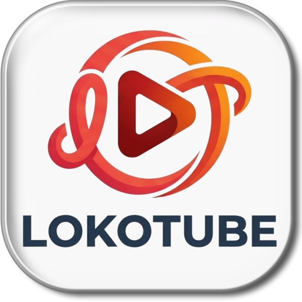

<div align="center">

# LokoTube Desktop



<br/>

**A desktop YouTube Music client for Windows, macOS & Linux — ad-free playback, synced lyrics, downloads, and one account that stays in sync with your phone.**

[](https://github.com/monzterz/LokoTube-Desktop/releases/latest)
[](https://github.com/monzterz/LokoTube-Desktop/releases/latest)
[](LICENSE)

<br/>

[**Download Latest Release**](https://github.com/monzterz/LokoTube-Desktop/releases/latest)

</div>

---

> **LokoTube Desktop is a fork of [Sonara](https://github.com/rashiiddsr/sonara) by [Rashid (@rashiiddsr)](https://github.com/rashiiddsr) — itself based on [Metrolist](https://github.com/MetrolistGroup/Metrolist) — continued and developed independently. The original authors are credited below.**

## Features

- **Ad-free playback** — YouTube Music streaming with no ads and no clutter
- **One account, every device** — sign in once; your library, playlists, likes and history stay in sync with the LokoTube phone app
- **Synced lyrics** — word-by-word lyrics from eight sources, with optional AI translation into your language
- **Full player & mini player** — a full-screen player with big lyrics, plus an always-on-top mini player
- **Sound** — equalizer, crossfade, volume normalization and mono audio
- **Downloads** — keep songs for offline listening, and save **videos** to your Videos folder as one playable file
- **Radio & autoplay** — endless music from any song or artist
- **Playlists** — create, edit, reorder and import from a link
- **Sleep timer** — stop after a set time or at the end of the song
- **Video & Shorts** — watch regular YouTube videos in a dedicated section and scroll a vertical Shorts feed: autoplay, quality switching, full screen, and a sidebar of what's next
- **Save videos** — one click writes a single `.mp4`/`.webm` to `~/Videos/LokoTube` (stream-copied, not re-encoded)
- **Comments, description & subscribing** — the watch page carries the channel strip with a Subscribe button, and the sidebar holds the comments (with likes and replies, a page at a time) and the video's full description, selectable for copying
- **Media keys** — system media controls on Windows, macOS and Linux (GNOME/KDE)
- **Tray & menu bar** — keep playing from the tray or menu bar, and start at sign-in

---

## Download

[**Download Latest Release**](https://github.com/monzterz/LokoTube-Desktop/releases/latest)

Windows 10/11 (64-bit) · macOS 12+ (Apple Silicon & Intel) · Linux (64-bit .deb / AppImage)

---

## Install

<details>
<summary><b>Windows</b> · <code>.msi</code></summary>

1. Run the MSI. If SmartScreen appears, choose **More info → Run anyway**.
2. Follow the installer; it installs for your user, no administrator needed.
3. A newer version replaces the old one and keeps your data.

</details>

<details>
<summary><b>macOS</b> · <code>.dmg</code></summary>

Take **arm64** for Apple Silicon (M1 and later), **intel** for Intel. Not sure? Apple menu → **About This Mac**.

1. Open the DMG and drag **LokoTube** into **Applications**.
2. Open LokoTube. The app isn't signed by Apple, so macOS asks first: go to **System Settings → Privacy & Security** and click **Open Anyway**.
3. If macOS says the app is damaged or can't be opened, run once in Terminal:

   ```bash
   sudo xattr -dr com.apple.quarantine /Applications/LokoTube.app
   ```

</details>

<details>
<summary><b>Linux</b> · <code>.deb</code> / <code>.AppImage</code></summary>

**Debian, Ubuntu, Linux Mint and the like** — install the .deb:

```bash
sudo apt install ./LokoTube-*-linux-amd64.deb
```

**Any other distribution** — the AppImage runs as-is:

```bash
chmod +x LokoTube-*-linux-x86_64.AppImage
./LokoTube-*-linux-x86_64.AppImage
```

Signing in opens Google's page in Chrome, Chromium, Edge, Brave or Vivaldi (Firefox can't be used for it), so one of them needs to be installed.

</details>

---

## Keyboard shortcuts

`Ctrl` on Windows and Linux, `⌘` on a Mac.

| Keys | Does |
|---|---|
| `Ctrl/⌘ K` | Search |
| `Space` / `K` | Play / pause |
| `Ctrl/⌘ →` / `Ctrl/⌘ ←` | Next / previous song |
| `→` / `←` | Forward / back 5 seconds |
| `L` / `J` | Forward / back 10 seconds |
| `↑` / `↓` | Volume up / down |
| `M` | Mute |
| `F` | Full screen |
| `Q` | Queue |
| `Ctrl/⌘ L` | Lyrics |
| `Ctrl/⌘ S` / `Ctrl/⌘ R` | Shuffle / repeat |
| `Ctrl/⌘ D` | Like the song |
| `Ctrl/⌘ ,` | Settings |
| `↑` / `↓` | In Shorts: previous / next Short (also the mouse wheel) |
| `F11` | Video full screen |

---

## Build

Requires JDK 21; the Android app also needs the Android SDK.

```bash
./gradlew :app:assembleFossRelease        # Android APK
./gradlew -p desktop packageInstaller     # Windows installer (on Windows)
./gradlew -p desktop packageDmg           # macOS disk image (on a Mac)
./gradlew -p desktop packageDeb           # Linux .deb (on Linux)
./gradlew -p desktop run                  # run the desktop app
```

No Mac or Linux at hand? The macOS and Linux app workflows in the **Actions** tab build them on GitHub's machines. More notes are in [AGENTS.md](AGENTS.md).

Tests that call YouTube (everything under `playback`) are opt-in — CI runners share a throttled IP:
`./gradlew -p desktop test -PliveTests`.

---

## Disclaimer

LokoTube Desktop is an independent, open-source project and is **not affiliated with or endorsed by Google LLC or YouTube**. All content is streamed directly from YouTube's servers for personal use. Provided "as is" under the GPL-3.0 license without warranty; users are responsible for complying with YouTube's Terms of Service and applicable copyright laws.

---

## License

Original code Copyright (C) 2026 [Rashid (@rashiiddsr)](https://github.com/rashiiddsr), based on [Metrolist](https://github.com/MetrolistGroup/Metrolist). Licensed under GPLv3. See [LICENSE](LICENSE).

LokoTube Desktop modifications are also licensed under GPL-3.0.
